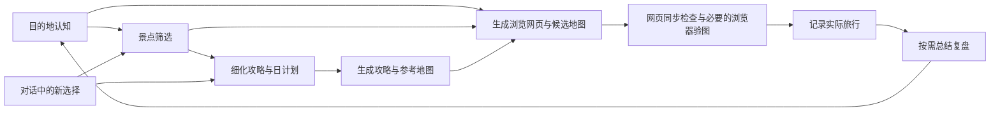

# 从目的地认知到旅行复盘

本模板把长期知识、本次计划、实际经历分别维护。对话先改变对应的源文件；已排日程的攻略和地图由同一份源数据生成。目的地知识可供后续旅程复用，测试资料不参与正式计划。

## 目录与责任

```text
project.json                       模板版本
travel/
  destinations/<destination-id>/   长期目的地知识
    destination.json              名称、稳定ID、当地时区
    overview.md                   一页认知：地理、体验类型、文化、关键未知
    discovery.json                可选：区域、展示顺序、参考码头与认知地图范围（不是日程）
    maps/                         区域/候选参考图，注明来源与制作时间
    places/<place-id>/
      place.json                  景点唯一知识源：交通、费用、饮食、购物等
      notes.md                    可选：额外研究记录，不能代替事实来源
      references/                 可选：有权保存的辅助资料与图片
    anchors/<anchor-id>/
      anchor.json                 酒店、机场、车站；区别代表点与合法入口
  trips/<trip-id>/                 一次实际旅程（未出发也属于正式资料）
    trip.json                     目的地、日期范围、酒店、机场、交通方式
    requirements.md               用户需求；未提供的保持未知
    selection.json                候选/优先/排除意向、理由与阻碍
    candidates.md                 自动生成的全部候选对照表
    decisions.md                  对话中的选择、取舍、变更依据
    days/day-01.json               当天景点、顺序、时段、取消及理由
    journal/YYYY-MM-DD.md          实际经历；有记录后才创建
    reviews/                      用户要求时创建的游记和复盘
    cache/routes/                 有向道路缓存；可刷新，不当作永久事实
    generated/day-01/             自动生成的攻略、候选视图、落脚点及地图
      itinerary.md
      places/<place-id>/README.md
      places/<place-id>/maps/      每景点位置参考图
      maps/                       当天完整线路 GeoJSON/PNG/HTML
      routing.json                道路、距离、模型车程及来源
      manifest.json               源摘要及输出文件散列
    site/day-01/                  自动生成的地图预览副本
skills/travel-workflow/            本地 Skill、唯一模板源、生成器
scripts/                          项目命令入口、道路获取与本地预览
docs/                             工作流程与数据约定
  site/<trip-id>/                  每次攻略更新后的浏览网页发布快照，纳入GitHub
    index.html                    概览、酒店、地图、候选筛选与已生成日程入口
    recognition.geojson           候选与酒店/机场/码头的位置，不是线路
    nearby.svg / regional.svg     离线经纬度位置示意
    manifest.json                 网页输入摘要与输出散列
tests/                            仅开发母项目包含
  fixtures/kota-kinabalu/          固定模拟输入，包括道路响应
  evidence/                       历史验收记录，不是旅行复盘
  output/                         可重建测试输出，不是实际计划
```

没有实际经历时，`journal/` 与 `reviews/` 为空；不批量创建空游记。模板不保存护照、银行卡等资料；如确需保存预订附件，放本次旅程自选的 `private/`，不要放可被预览服务访问的目录。

## 六个阶段如何衔接

| 阶段 | 主要输入 | 维护的位置 | 进入下一步的条件 |
|---|---|---|---|
| 目的地认知 | 官方介绍、地图、用户问题 | `overview.md`、`maps/`、少量 `place.json` | 能分清区域、体验类型、主要限制和未知 |
| 景点筛选 | 用户需求、体验取舍、时间预算 | `requirements.md`、`selection.json`、`decisions.md` | 优先项与排除理由明确；不要求把所有候选写成完整攻略 |
| 攻略细化 | 入选景点、具体日期、来源核实 | `place.json`、`anchor.json`、`days/` | 已排景点有坐标和时段；入口、费用、开放等未知有标记 |
| 对话调整 | 取消、改时间、换酒店或交通 | 对应源文件、`decisions.md`，然后 `build/check` | 攻略、地图、编号、费用小计同步；时间变化重新考虑拍照/饮食 |
| 旅行记录 | 用户当日描述、票据、真实观察 | `journal/`，必要时纠正知识源 | 清楚区分计划与实际；未发生的事不记为完成 |
| 复盘 | 日志、决策、计划与对话证据 | `reviews/`，按需复制复盘模板 | 用户提出总结请求；记录依据、认知变化、取舍与下次改进 |



## 一次对话变更的操作顺序

1. 读已有目的地和旅程，不重复建立同一个景点；先分清新事实、用户决定、建议和实际经历。
2. 改唯一源文件。例如只取消某天景点：从该日 `stops` 移到 `cancelled` 并写原因；保留景点文件，筛选意向可继续作为以后备用。
3. 在 `decisions.md` 记录原因和依据。酒店或机场修改只改 `trip.json` 引用，位置修正改 `anchor.json`。
4. 新方向或新坐标缺少道路时执行 `fetch`。普通 `build/check` 不联网；读取缓存也不意味着票价、营业或道路限制已重新核实。
5. 对受影响的每个日计划执行 `build` 与 `check`。只处理有变化的日期；不要为了更新一个日程重写整个旅行资料库。
6. **每次攻略更新都生成网页**：运行 `web --trip <id>`，再运行 `web-check --trip <id>`。认知/筛选阶段可以保持所有日计划为空；已 ready 的日计划必须先 build/check 通过，网页才引用其攻略与地图。
7. 运行 `web-serve --trip <id> --port 8766`，打开 `http://127.0.0.1:8766/<trip-id>/`。检查实际浏览效果；地图或交互变化时验证底图、落脚点、筛选、弹窗与临时比较。交付网页链接，不能只交付JSON或声称HTML生成即浏览验证通过。
8. 按对话授权同步 GitHub：源资料、工作流及 `docs/site/` 发布快照一起提交，并核对远端。旅程 `generated/`、`site/` 工作副本、依赖、缓存和私人附件继续忽略。GitHub文件页不执行HTML；当前使用本机浏览入口，尚未启用在线网站托管。复盘文档不会随普通攻略更新刷新。

## 网页与筛选的边界

认知页从 `requirements.md`、`overview.md`、`discovery.json`、每景点的 `place.json`、落脚点与 `selection.json` 生成。卡片、GeoJSON、位置图和候选表共用点位和状态；地图编号是展示编号，禁止解释为行程顺序。位置图不画未经路由的道路或船行线，酒店直线距离只用于判断地理尺度。

收到新偏好时，先更新旅程requirements.md，在selection.json的fit与blockers中逐项说明匹配与取舍，记录decisions.md。推荐级别不替代用户意向，status只在用户作出选择后更改；目的地知识仍保持可复用。地图图例与点位颜色同源，颜色表示区域而非距离或推荐等级。

网页的区域/类型/文字筛选是查看工具；“比较”仅保存在页面内存，刷新即清空。复制初筛清单到对话、明确用户意向后，才修改 `selection.json`，随后重建网页。不能把浏览测试中的勾选当成用户已选。网页只发布明确允许的攻略字段和经检查的日计划生成物，不复制 `journal/`、`reviews/` 或 `private/`。

## 可复用范围

目录与工作流适用于不同目的地。当前制图引擎验收的是单日最多三个活动景点、酒店和机场、汽车路线或明确标注的顺序示意图；费用字段仍为 MYR 已知门票小计。多个日文件可以分别生成，但不是已验证的跨日交通、换酒店、多目的地或全程优化系统。出行日期未知时不能承诺开放、天气、日落或接送时刻。
