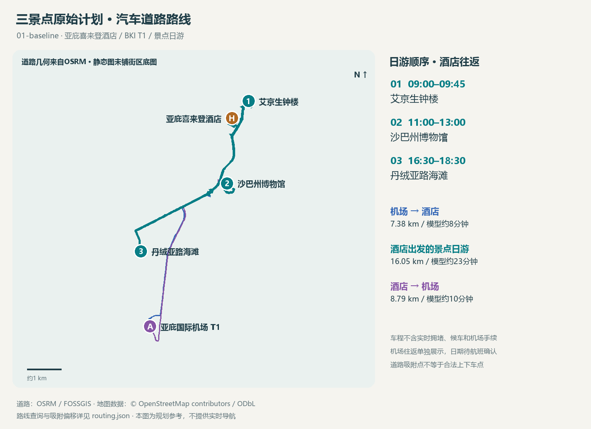

<!-- source-digest: ce6e8ed1c0a70e29a75ebd17d320cae87cbd5acfa832a3d7bfd4de72b4dba150 -->
# 一日计划 · 三景点原始计划

版本：01-baseline。模拟计划；旅行日期：未定；未记录实际出行。时区：Asia/Kuching。

仅为验证：1名成人，门票参照非马来西亚游客档；无用户国籍假设。

## 游玩顺序

| 顺序 | 时间 | 景点 | 本次安排 |
|---|---|---|---|
| 1 | 09:00–09:45 | [艾京生钟楼](places/atkinson-clock-tower/README.md) | 上午拍钟楼外观及街景；机位以公共可达区域为准。 |
| 2 | 11:00–13:00 | [沙巴州博物馆](places/sabah-museum/README.md) | 先核实可开放区域和拍摄规定，再拍建筑；展品拍摄遵循现场要求。 |
| 3 | 16:30–18:30 | [丹绒亚路海滩](places/tanjung-aru/README.md) | 傍晚留出海岸与日落拍照时段；确切日落时间、云量与可达机位待日期确定后核实。 |

## 休息与转场

- 09:45–11:00 转场与缓冲；道路模型车程见交通表，候车与实时路况待查
- 13:00–16:30 午餐、休息与转场；餐厅待选

## 费用

已知门票小计：RM15。**不是旅行总费用**。

入场相关费用待核实：艾京生钟楼、丹绒亚路海滩；交通、餐饮、购物与装备费用均未计入。已取消景点的参考票价不计入本次小计。

## 条件与待确认

- 博物馆须先确认开放范围；此为有条件计划
- 18:30仅为示例结束时间，不是经核实的日落时刻
- 真实道路路线为OSRM模型；不含实时堵车、候车和价格
- BKI T1接送待航班确认，往返不假设与日游同一天

## 汽车道路路线

路线来源：OSRM / FOSSGIS (OpenStreetMap)，按有向路段分别查询。以下耗时为路网估算，不含实时拥堵、候车、停车、上下车与机场手续。

| 分段 | 起点 → 终点 | 道路距离 | 模型车程 |
|---|---|---|---|
| 机场 → 酒店 | 亚庇国际机场 T1 → 亚庇喜来登酒店 | 7.38 km | 约8分钟 |
| 酒店出发的景点日游 | 亚庇喜来登酒店 → 艾京生钟楼 | 2.16 km | 约4分钟 |
| 酒店出发的景点日游 | 艾京生钟楼 → 沙巴州博物馆 | 3.81 km | 约6分钟 |
| 酒店出发的景点日游 | 沙巴州博物馆 → 丹绒亚路海滩 | 4.40 km | 约7分钟 |
| 酒店出发的景点日游 | 丹绒亚路海滩 → 亚庇喜来登酒店 | 5.66 km | 约8分钟 |
| 酒店 → 机场 | 亚庇喜来登酒店 → 亚庇国际机场 T1 | 8.79 km | 约10分钟 |

各段分钟数向上取整；汇总以原始秒数相加后取整，可能与逐段显示值之和略有差别。

- 机场 → 酒店：7.38 km，模型车程约8分钟。
- 酒店出发的景点日游：16.05 km，模型车程约23分钟。
- 酒店 → 机场：8.79 km，模型车程约10分钟。

日游建议酒店出发 08:41，返回参考 18:53；每段另留15分钟规划缓冲，不是服务方承诺。

机场接送日期和航班时刻未定，往返分别展示，未排入日游当天。T1、到达/出发楼层和接送点须按航班确认。

路线使用地图代表点吸附到可路由道路；吸附不证明该处是合法上下车点。各段偏移和来源见 routing.json。

汽车/出租车费用尚未报价；道路距离与车程不能当成计费结果。

[酒店与机场信息](anchors.md) · [逐段原始指标](routing.json)

## 配套地图

[交互地图](maps/route.html) · [GeoJSON](maps/route.geojson)

实线沿OSRM汽车路网，机场往返与日游分层；上下车点仍需现场核对。

## 本次选择

建立城市历史—地方文化—海滨风景的三点样本。

取消记录：无。
