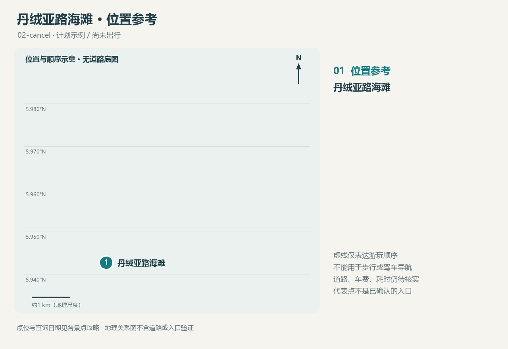

<!-- source-digest: 7cac7d5da49ac27d390caf04b698ad70fc379978b162da9dcda788835a97bcc0 -->
# 丹绒亚路海滩

Tanjung Aru Beach / Pantai Tanjung Aru

**本次第2站 · 16:30–18:30 · 计划，未实际游览**

## 为什么考虑这里

沙巴旅游局将这里介绍为欣赏日落、野餐和放风筝的海滩；名称与沿岸的aru木麻黄树有关。

适合海边散步与风景摄影；看日落需要保留傍晚时段，上午安排不能替代日落体验。

建议停留：约1.5–2小时（本次规划建议，不含交通）

## 本次汽车交通更新

- 艾京生钟楼 → 丹绒亚路海滩：6.44 km，模型车程约8分钟。
- 丹绒亚路海滩 → 亚庇喜来登酒店：5.66 km，模型车程约8分钟。

以上为本次已查询的道路数据，更新下面知识库中的交通待查状态；不含实时拥堵、候车与车费。[本次道路地图](../../maps/route.html)

## 交通与位置

向司机出示 Tanjung Aru Beach / Pantai Tanjung Aru，并核对现场合法入口与上下车点。本次汽车道路指标见上方更新；公交、步行路线、实时报价和拥堵情况仍待核实。原研究资料保留在知识源中。

坐标：[116.048889, 5.942778]（经度、纬度）；海滩代表点，范围较长；不是已核实的集合点或上下车点。

[位置图](maps/route.html) · [GeoJSON](maps/route.geojson)

## 开放与费用

公共可达范围、设施与临时活动待出行前确认；本次不规划水上活动。

本次未核实入场、停车、设施等费用，预算不能按零元总费用处理。

## 食物

旅游局介绍有小吃摊；具体摊位营业、价格及过敏原现场确认。上午改期后，不保证摊位仍按傍晚情况营业。

## 购物

本次不安排购物；海滩摊位不作为已核实的采购点。

## 本次拍照安排

傍晚留出海岸与日落拍照时段；确切日落时间、云量与可达机位待日期确定后核实。

## 装备

建议防晒、帽子、饮水、雨具和防沙收纳袋；保护相机避免接触海水。

## 语言

向司机出示选定入口；可问 ‘Where can I meet the driver?’。

## 风土人情观察问题

观察当地人与游客如何使用海滨公共空间；尚无实际观察，不写成旅行体验。

## 来源与待核实

查询日期：2026-10-21。查询日期不等于事实生效日期；建议与事实分开理解。

- [沙巴旅游局：丹绒亚路海滩](https://sabahtourism.com/destination/tanjung-aru-beach/)
- [坐标来源](https://www.wikidata.org/wiki/Q877363)

这是一份计划资料，不是游记。个人笔记在源目录 notes.md 中维护。
