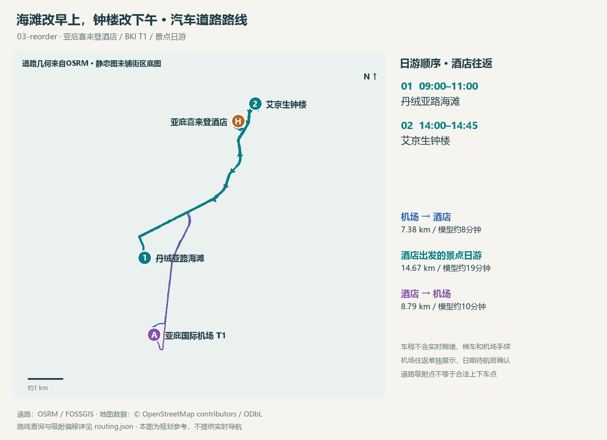

<!-- source-digest: fc9117e1238fa8ad47d7c718134c259e629a50298cf9effd9dab3fb635253883 -->
# 一日计划 · 海滩改早上，钟楼改下午

版本：03-reorder。模拟计划；旅行日期：未定；未记录实际出行。时区：Asia/Kuching。

仅为验证：1名成人，门票参照非马来西亚游客档；无用户国籍假设。

## 游玩顺序

| 顺序 | 时间 | 景点 | 本次安排 |
|---|---|---|---|
| 1 | 09:00–11:00 | [丹绒亚路海滩](places/tanjung-aru/README.md) | 上午海边散步、拍木麻黄和海岸；本次不安排日落拍照。 |
| 2 | 14:00–14:45 | [艾京生钟楼](places/atkinson-clock-tower/README.md) | 下午拍钟楼与街区关系；现场观察光线，避开车辆通行空间。 |

## 休息与转场

- 11:00–14:00 午餐、休息与转场；道路模型车程见交通表，候车与实时路况待查

## 费用

已知门票小计：RM0。**不是旅行总费用**。

入场相关费用待核实：丹绒亚路海滩、艾京生钟楼；交通、餐饮、购物与装备费用均未计入。已取消景点的参考票价不计入本次小计。

## 条件与待确认

- 海滩上午游览不含日落
- 餐饮营业与司机接送位置需随时段复核
- 真实道路路线为OSRM模型；不含实时堵车、候车和价格
- BKI T1接送待航班确认，往返不假设与日游同一天

## 汽车道路路线

路线来源：OSRM / FOSSGIS (OpenStreetMap)，按有向路段分别查询。以下耗时为路网估算，不含实时拥堵、候车、停车、上下车与机场手续。

| 分段 | 起点 → 终点 | 道路距离 | 模型车程 |
|---|---|---|---|
| 机场 → 酒店 | 亚庇国际机场 T1 → 亚庇喜来登酒店 | 7.38 km | 约8分钟 |
| 酒店出发的景点日游 | 亚庇喜来登酒店 → 丹绒亚路海滩 | 6.42 km | 约9分钟 |
| 酒店出发的景点日游 | 丹绒亚路海滩 → 艾京生钟楼 | 6.90 km | 约9分钟 |
| 酒店出发的景点日游 | 艾京生钟楼 → 亚庇喜来登酒店 | 1.35 km | 约3分钟 |
| 酒店 → 机场 | 亚庇喜来登酒店 → 亚庇国际机场 T1 | 8.79 km | 约10分钟 |

各段分钟数向上取整；汇总以原始秒数相加后取整，可能与逐段显示值之和略有差别。

- 机场 → 酒店：7.38 km，模型车程约8分钟。
- 酒店出发的景点日游：14.67 km，模型车程约19分钟。
- 酒店 → 机场：8.79 km，模型车程约10分钟。

日游建议酒店出发 08:36，返回参考 15:03；每段另留15分钟规划缓冲，不是服务方承诺。

机场接送日期和航班时刻未定，往返分别展示，未排入日游当天。T1、到达/出发楼层和接送点须按航班确认。

路线使用地图代表点吸附到可路由道路；吸附不证明该处是合法上下车点。各段偏移和来源见 routing.json。

汽车/出租车费用尚未报价；道路距离与车程不能当成计费结果。

[酒店与机场信息](anchors.md) · [逐段原始指标](routing.json)

## 配套地图

[交互地图](maps/route.html) · [GeoJSON](maps/route.geojson)

实线沿OSRM汽车路网，机场往返与日游分层；上下车点仍需现场核对。

## 本次选择

模拟更改游览顺序：上午海边，下午城市历史；本次放弃日落时段。

取消记录：沙巴州博物馆：承接上一步模拟取消；资料保留。
