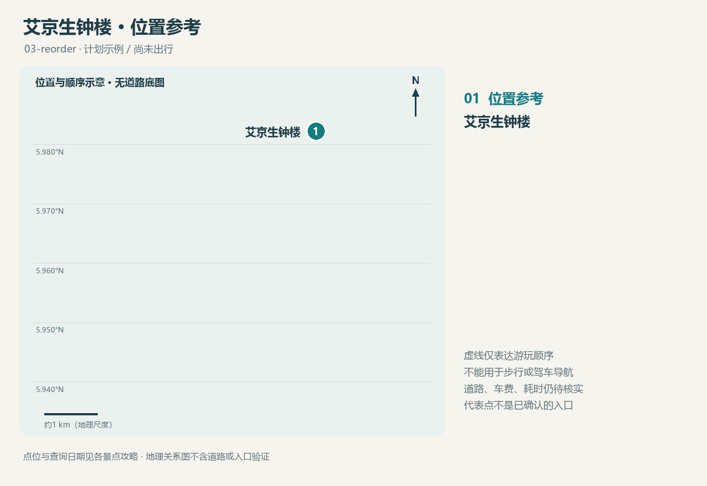

<!-- source-digest: fc9117e1238fa8ad47d7c718134c259e629a50298cf9effd9dab3fb635253883 -->
# 艾京生钟楼

Atkinson Clock Tower / Menara Jam Atkinson

**本次第2站 · 14:00–14:45 · 计划，未实际游览**

## 为什么考虑这里

建于1905年的纪念钟楼，可作为认识亚庇城市历史的入口。背景资料来自沙巴旅游局日文介绍；本次只安排外观观察。

适合喜欢城市历史、愿意短暂停留的人；若期待大型展览，可降低优先级。

建议停留：30–45分钟（本次规划建议，非官方规定）

## 本次汽车交通更新

- 丹绒亚路海滩 → 艾京生钟楼：6.90 km，模型车程约9分钟。
- 艾京生钟楼 → 亚庇喜来登酒店：1.35 km，模型车程约3分钟。

以上为本次已查询的道路数据，更新下面知识库中的交通待查状态；不含实时拥堵、候车与车费。[本次道路地图](../../maps/route.html)

## 交通与位置

向司机出示 Atkinson Clock Tower / Menara Jam Atkinson，并核对现场合法入口与上下车点。本次汽车道路指标见上方更新；公交、步行路线、实时报价和拥堵情况仍待核实。原研究资料保留在知识源中。

坐标：[116.077306, 5.982194]（经度、纬度）；地标位置；不是已核实的上下车点或入口。

[位置图](maps/route.html) · [GeoJSON](maps/route.geojson)

## 开放与费用

旅游局2023年文章曾提示临时关闭；这不能证明2026年仍关闭或已经重开。近距离通道和可参观范围待出行前确认。

外观参观费用未核实；不把未知写成免费。

## 食物

建议在市区另设午餐时段；具体店铺、营业时间、饮食要求待选，不预填推荐商家。

## 购物

本次无购物任务；若想购买城市文化相关书籍或纪念品，另查店铺与营业信息。

## 本次拍照安排

下午拍钟楼与街区关系；现场观察光线，避开车辆通行空间。

## 装备

建议带饮水、防晒、轻便雨具和舒适步行鞋；天气待出行日期确定后查询。

## 语言

向司机展示 Atkinson Clock Tower；问路可用 ‘Where is the public entrance?’。

## 风土人情观察问题

观察纪念性建筑如何参与城市记忆；这是待观察问题，不代表已经游览或认同某种历史叙事。

## 来源与待核实

查询日期：2026-10-21。查询日期不等于事实生效日期；建议与事实分开理解。

- [沙巴旅游局：钟楼介绍（2023年资料）](https://japan.sabahtourism.com/2023/06/08/%E6%B0%97%E8%BB%BD%E3%81%AB%E8%A1%8C%E3%81%91%E3%82%8B%E3%82%B3%E3%82%BF%E3%82%AD%E3%83%8A%E3%83%90%E3%83%AB%E3%81%AE%E8%A6%B3%E5%85%89%E5%90%8D%E6%89%80%E3%80%81%E3%82%A2%E3%83%88%E3%82%AD%E3%83%B3/)
- [坐标来源](https://www.wikidata.org/wiki/Q4281727)

这是一份计划资料，不是游记。个人笔记在源目录 notes.md 中维护。
