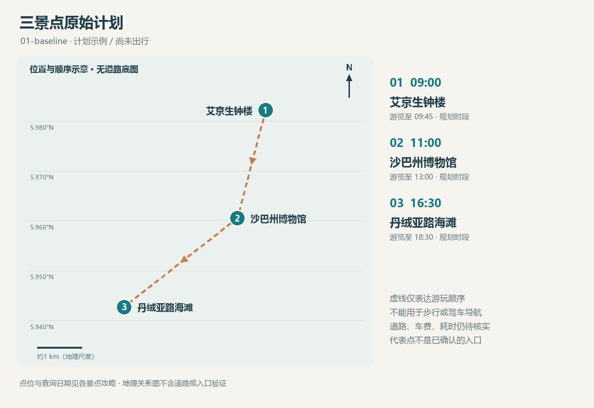

<!-- source-digest: 17a7524692a5e3dd2388c845f778d2260a18f4c6cb4af95fd3d0120ceeba4e18 -->
# 一日计划 · 三景点原始计划

版本：01-baseline。模拟计划；旅行日期：未定；未记录实际出行。时区：Asia/Kuching。

仅为验证：1名成人，门票参照非马来西亚游客档；无用户国籍假设。

## 游玩顺序

| 顺序 | 时间 | 景点 | 本次安排 |
|---|---|---|---|
| 1 | 09:00–09:45 | [艾京生钟楼](places/atkinson-clock-tower/README.md) | 上午拍钟楼外观及街景；机位以公共可达区域为准。 |
| 2 | 11:00–13:00 | [沙巴州博物馆](places/sabah-museum/README.md) | 先核实可开放区域和拍摄规定，再拍建筑；展品拍摄遵循现场要求。 |
| 3 | 16:30–18:30 | [丹绒亚路海滩](places/tanjung-aru/README.md) | 傍晚留出海岸与日落拍照时段；确切日落时间、云量与可达机位待日期确定后核实。 |

## 休息与转场

- 09:45–11:00 交通与缓冲；真实耗时待查
- 13:00–16:30 午餐、休息与转场；餐厅和道路待选

## 费用

已知门票小计：RM15。**不是旅行总费用**。

入场相关费用待核实：艾京生钟楼、丹绒亚路海滩；交通、餐饮、购物与装备费用均未计入。已取消景点的参考票价不计入本次小计。

## 条件与待确认

- 博物馆须先确认开放范围；此为有条件计划
- 18:30仅为示例结束时间，不是经核实的日落时刻

## 配套地图

[交互地图](maps/route.html) · [GeoJSON](maps/route.geojson)

仅为游玩顺序，未获得道路导航几何、车程或公交数据。

## 本次选择

建立城市历史—地方文化—海滨风景的三点样本。

取消记录：无。
