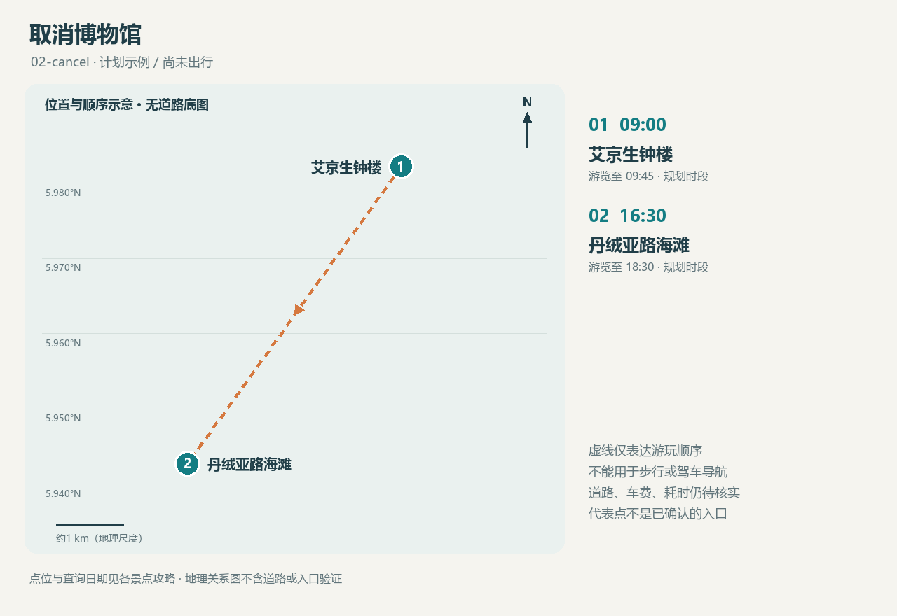

<!-- source-digest: b2f6d80872590bb3549bd15f61cbaf29e421411f0aec5ce8aed16c4d65cad140 -->
# 一日计划 · 取消博物馆

版本：02-cancel。模拟计划；旅行日期：未定；未记录实际出行。时区：Asia/Kuching。

仅为验证：1名成人，门票参照非马来西亚游客档；无用户国籍假设。

## 游玩顺序

| 顺序 | 时间 | 景点 | 本次安排 |
|---|---|---|---|
| 1 | 09:00–09:45 | [艾京生钟楼](places/atkinson-clock-tower/README.md) | 上午拍钟楼外观及街景；机位以公共可达区域为准。 |
| 2 | 16:30–18:30 | [丹绒亚路海滩](places/tanjung-aru/README.md) | 傍晚留出海岸与日落拍照时段；确切日落时间、云量与可达机位待日期确定后核实。 |

## 休息与转场

- 09:45–16:30 自由午餐、休息与交通缓冲；空档不强行填满景点

## 费用

已知门票小计：RM0。**不是旅行总费用**。

入场相关费用待核实：艾京生钟楼、丹绒亚路海滩；交通、餐饮、购物与装备费用均未计入。已取消景点的参考票价不计入本次小计。

## 条件与待确认

- 确切日落时间与返程交通待日期确定后核实

## 配套地图

[交互地图](maps/route.html) · [GeoJSON](maps/route.geojson)

仅为游玩顺序，未获得道路导航几何、车程或公交数据。

## 本次选择

模拟用户取消博物馆；保留研究资料，增加休息空间。

取消记录：沙巴州博物馆：模拟取消；不是实际去过或确认闭馆。
