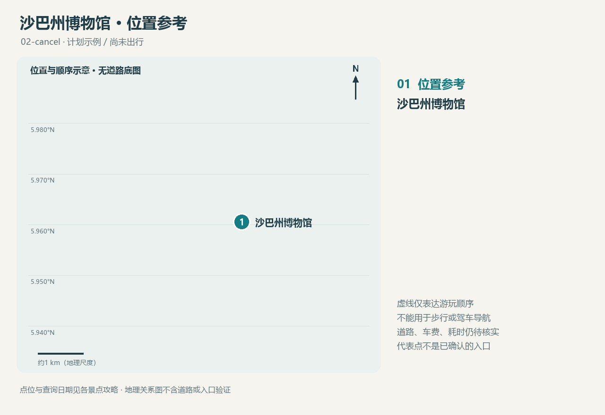

<!-- source-digest: b2f6d80872590bb3549bd15f61cbaf29e421411f0aec5ce8aed16c4d65cad140 -->
# 沙巴州博物馆

Sabah Museum / Muzium Sabah

**本次已取消 · 模拟取消；不是实际去过或确认闭馆**

## 为什么考虑这里

馆区呈现沙巴历史与不同社群的文化资料。官网介绍主馆建筑借鉴Rungus长屋形式，并介绍文化村；具体可参观内容需核实。

适合想先建立沙巴文化背景的人；本次因测试取消保留为候选。

建议停留：约2小时（本次规划建议，取决于实际开放范围）

## 交通与位置

目的地使用 Sabah Museum 主馆区，避免与其他同名分馆混淆。道路、公共交通和叫车费用待核实；坐标不是停车入口。

坐标：[116.071667, 5.960556]（经度、纬度）；馆区代表点；不是已核实的上下车点或入口。

[位置图](maps/route.html) · [GeoJSON](maps/route.geojson)

## 开放与费用

常规页面列每日09:00–17:00；官网仍保留2024年主楼展厅关闭公告。本次未确认重开日期，不能据常规时间断言主馆可进入。

官网列非马来西亚游客RM15；仅作1名非马来西亚成人的测试参考价，不代表用户身份或实际应付票价。

## 食物

不依赖未经核实的馆内餐饮；建议参观前后另安排午餐。

## 购物

官网有 Museum Shop 入口；不据此保证现场商店营业、价格或库存。

## 本次拍照安排

本次无拍照安排；知识资料保留。

## 装备

建议轻便鞋、饮水和雨具；若参观户外文化村需考虑日晒。

## 语言

可问 ‘Which galleries are open today?’ 与 ‘Is photography allowed?’。

## 风土人情观察问题

留意不同社群的名称与建筑形式，避免把沙巴文化概括为单一传统；游后用实际记录补充。

## 来源与待核实

查询日期：2026-10-21。查询日期不等于事实生效日期；建议与事实分开理解。

- [沙巴博物馆：馆区、票价及常规时间](https://museum.sabah.gov.my/node/68)
- [主楼展厅关闭公告（官网仍保留；重开情况待查）](https://museum.sabah.gov.my/node/200)
- [坐标来源](https://www.wikidata.org/wiki/Q2209383)

这是一份计划资料，不是游记。个人笔记在源目录 notes.md 中维护。
