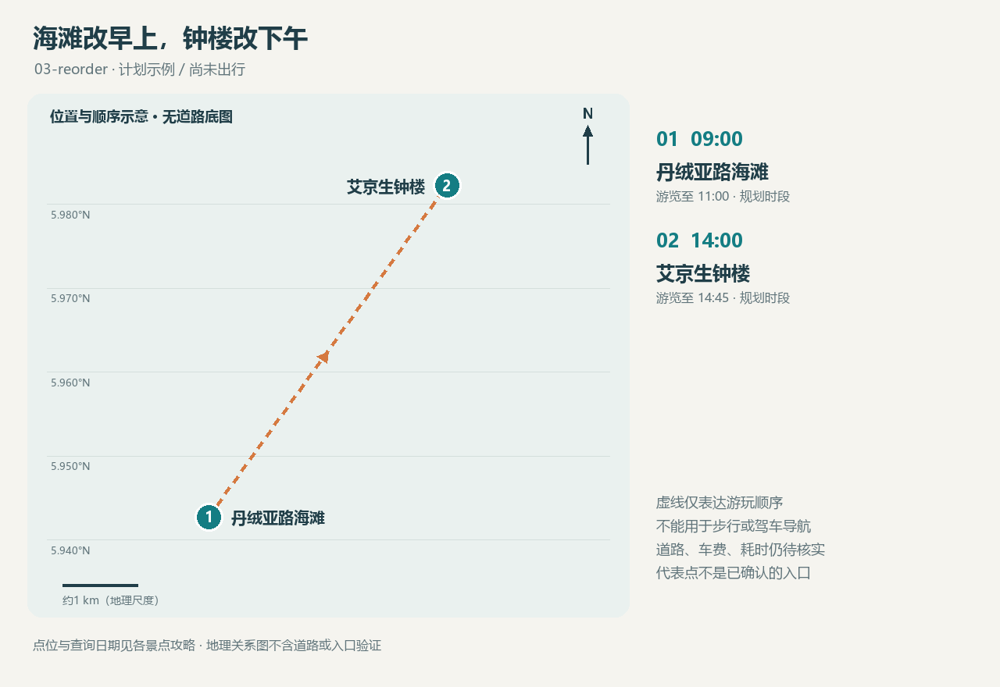

<!-- source-digest: 48c50cdebc821dd54cff2f6c767ed1975dfbc2a3b32b5d2544f53cfeb2133bd4 -->
# 一日计划 · 海滩改早上，钟楼改下午

版本：03-reorder。模拟计划；旅行日期：未定；未记录实际出行。时区：Asia/Kuching。

仅为验证：1名成人，门票参照非马来西亚游客档；无用户国籍假设。

## 游玩顺序

| 顺序 | 时间 | 景点 | 本次安排 |
|---|---|---|---|
| 1 | 09:00–11:00 | [丹绒亚路海滩](places/tanjung-aru/README.md) | 上午海边散步、拍木麻黄和海岸；本次不安排日落拍照。 |
| 2 | 14:00–14:45 | [艾京生钟楼](places/atkinson-clock-tower/README.md) | 下午拍钟楼与街区关系；现场观察光线，避开车辆通行空间。 |

## 休息与转场

- 11:00–14:00 午餐、休息与转场；交通耗时待查

## 费用

已知门票小计：RM0。**不是旅行总费用**。

入场相关费用待核实：丹绒亚路海滩、艾京生钟楼；交通、餐饮、购物与装备费用均未计入。已取消景点的参考票价不计入本次小计。

## 条件与待确认

- 海滩上午游览不含日落
- 餐饮营业与司机接送位置需随时段复核

## 配套地图

[交互地图](maps/route.html) · [GeoJSON](maps/route.geojson)

仅为游玩顺序，未获得道路导航几何、车程或公交数据。

## 本次选择

模拟更改游览顺序：上午海边，下午城市历史；本次放弃日落时段。

取消记录：沙巴州博物馆：承接上一步模拟取消；资料保留。
